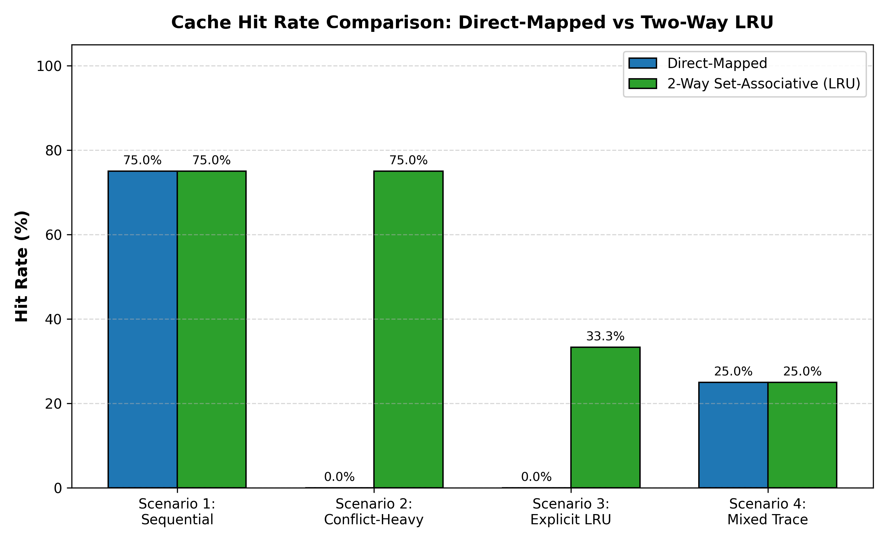
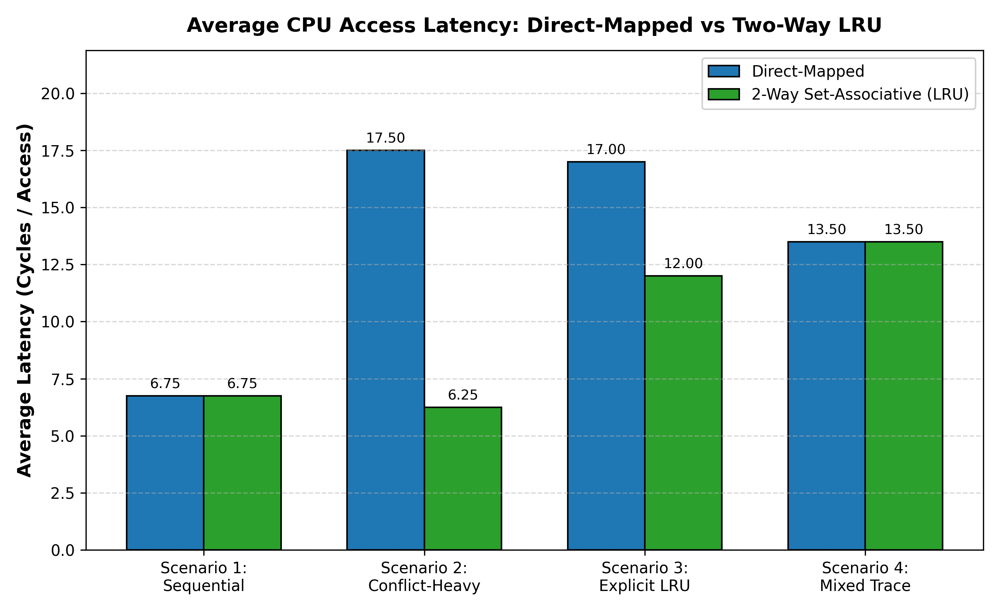
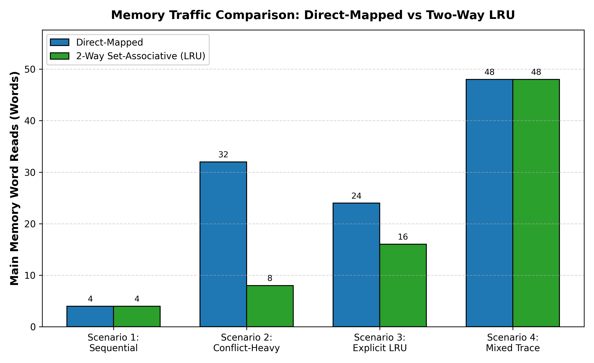

# Design and Performance Analysis of a Two-Way Set-Associative Cache with LRU Replacement Compared with a Direct-Mapped Cache

[](#)
[](#)
[](#)
[](report/ieee_phase1_report.pdf)
[](https://github.com/chinmay7980/2-Way-Set-Associative-Cache-with-LRU.git)

A cycle-accurate, synthesizable SystemVerilog hardware implementation and comparative performance analysis of two primary L1 cache architectures:
1. **8-Line Baseline Direct-Mapped Cache** (`direct_mapped_cache`)
2. **4-Set, 2-Way Set-Associative Cache with 1-Bit LRU Replacement** (`cache_2way_top`)

* **Institutional Affiliation**: Department of Computer Science and Artificial Intelligence, Newton School of Technology  
* **Official Authors**: Satyam Kumar, Krishna Verma, Akshit Vats, Chinmay Soni, Lakshya Bapna  
* **Project Repository**: [https://github.com/chinmay7980/2-Way-Set-Associative-Cache-with-LRU.git](https://github.com/chinmay7980/2-Way-Set-Associative-Cache-with-LRU.git)

Both designs feature identical data capacity (128 bytes), cache-line granularity (16 bytes = 4 words), 32-bit data word width, 32-bit byte-addressed memory interfaces, blocking single-request execution, and synchronous active-low reset. The architectures are subjected to identical deterministic access traces driven by an automated verification and performance benchmarking suite.

---

## 1. Problem Statement and Objectives

### The Memory Wall & Cache Locality
Processor execution frequency and arithmetic throughput continue to outpace off-chip DRAM access latency and bandwidth—a fundamental performance disparity widely formalized as the **memory wall**. High-speed on-chip cache hierarchies bridge this gap by exploiting:
- **Temporal Locality**: Data referenced recently is likely to be referenced again in the near future.
- **Spatial Locality**: Data items with storage addresses physically adjacent to a recently referenced address are likely to be accessed soon.

### Cache Miss Classification (Hill's 3C Model)
Cache misses fall into three classical categories:
1. **Compulsory (Cold) Misses**: Unavoidable initial references to a cache line that has never been loaded into the cache.
2. **Capacity Misses**: Occur when the active program working set exceeds the aggregate storage capacity of the cache.
3. **Conflict (Collision) Misses**: Occur when multiple active memory lines map to the identical cache line or set, causing premature mutual eviction despite unallocated capacity in other lines or sets.

### Phase I Project Objectives
- Design, model, and integrate a fully synthesizable **8-line direct-mapped cache** baseline in IEEE 1800-2012 SystemVerilog.
- Architect a modular **4-set, 2-way set-associative cache** featuring dual parallel tag comparators, way selection multiplexers, and a dedicated 1-bit per set **Least Recently Used (LRU)** controller.
- Implement robust, non-blocking **Ready/Valid handshakes** on both CPU and main memory bus interfaces, supporting parameterized multi-cycle memory latency and CPU backpressure.
- Empirically demonstrate the quantitative elimination of conflict thrashing through cycle-accurate Icarus Verilog simulation across four canonical synthetic workloads.
- Prepare a publication-grade academic report formatted to IEEE Conference specifications for **Phase I evaluation**.

---

## 2. Team Member Information and Technical Roles

### Official Student Authors & Affiliation
* **Department**: Department of Computer Science and Artificial Intelligence  
* **Institution**: Newton School of Technology  
* **Repository**: [https://github.com/chinmay7980/2-Way-Set-Associative-Cache-with-LRU.git](https://github.com/chinmay7980/2-Way-Set-Associative-Cache-with-LRU.git)

### Technical Work Package Allocation (Verified from Git Repository Records)

| Author Name | Role Identifier | Assigned Technical Work Package | Verified Git Deliverables |
|---|---|---|---|
| **Chinmay Soni** | Member 1 | Direct-Mapped Cache Baseline & Common System Package | `rtl/cache_pkg.sv`, `rtl/direct_mapped_cache.sv`, `tb/tb_direct_mapped.sv` |
| **Lakshya Bapna** | Member 2 | Two-Way Datapath Subsystem & Datapath Unit Verification | `rtl/cache_2way_datapath.sv`, `tb/tb_cache_2way_datapath.sv` |
| **Satyam Kumar** | Member 3 | LRU Controller, Cache FSM Sequencer, Top-Level Integration & Smoke Testing | `rtl/lru_controller.sv`, `rtl/cache_2way_controller.sv`, `rtl/cache_2way_top.sv`, `tb/tb_lru_controller.sv`, `tb/tb_cache_2way_smoke.sv` |
| **Krishna Verma** | Member 4 | Main Memory Subsystem, Dual-Cache Comparison Testbench, Analytics & Graphs | `sim/simple_main_memory.sv`, `tb/tb_cache_comparison.sv`, `analysis/analyze_results.py`, `results/results.csv`, `results/*.png` |
| **Akshit Vats** | Member 5 | Verification Support, Benchmark Validation & Academic Documentation | Synthetic trace verification, invariant assertion validation, results auditing, and IEEE report documentation support *(subject to team confirmation)* |

> [!NOTE]
> **Author Mapping Confirmation**:
> The core hardware microarchitecture was partitioned into four modular engineering work packages (Members 1 through 4) reflected in the Git commit records, with Member 5 contributing across verification support and documentation. All five authors are formally registered for the Phase I project evaluation.

---

## 3. Cache Microarchitecture & Address Field Breakdown

### Common Architectural Parameters

| Architectural Parameter | Direct-Mapped Baseline | 2-Way Set-Associative Cache |
|---|---|---|
| **Total Data Capacity** | 128 Bytes (32 Words) | 128 Bytes (32 Words) |
| **Cache Line (Block) Size** | 16 Bytes (4 Words) | 16 Bytes (4 Words) |
| **Words per Cache Line** | 4 Words (32 bits each) | 4 Words (32 bits each) |
| **Address Bus Width** | 32 Bits (Byte-addressed) | 32 Bits (Byte-addressed) |
| **Data Bus Width** | 32 Bits (Word-aligned) | 32 Bits (Word-aligned) |
| **Organization** | 8 Lines $\times$ 1 Way | 4 Sets $\times$ 2 Ways |
| **Tag Field Width** | 25 Bits (`addr[31:7]`) | 26 Bits (`addr[31:6]`) |
| **Index / Set Field Width** | 3 Bits (`addr[6:4]`) | 2 Bits (`addr[5:4]`) |
| **Word Select Field Width** | 2 Bits (`addr[3:2]`) | 2 Bits (`addr[3:2]`) |
| **Byte Offset Field Width** | 2 Bits (`addr[1:0]` = `2'b00`) | 2 Bits (`addr[1:0]` = `2'b00`) |
| **Tag Comparators** | 1 $\times$ 25-bit comparator | 2 $\times$ 26-bit parallel comparators |
| **Replacement Tracking** | None (Direct replacement) | 4 Bits (1 Bit per Set LRU) |
| **Access Policy** | Read-Only, Blocking | Read-Only, Blocking |
| **Reset Discipline** | Synchronous active-low (`rst_n`) | Synchronous active-low (`rst_n`) |

### Address Field Decoders

#### 1. Direct-Mapped Cache Address Breakdown (8 Lines $\times$ 16 Bytes)
```text
 31                                         7 6         4 3        2 1        0
+--------------------------------------------+-----------+----------+----------+
|               Tag (25 bits)                | Line (3b) | Word(2b) | Offset(2)|
+--------------------------------------------+-----------+----------+----------+
 [31:7] Tag: Compared against stored line tag
 [6:4]  Line Index: Directly addresses 1 of 8 cache lines (2^3 = 8)
 [3:2]  Word Index: Selects 1 of 4 words within the line (2^2 = 4)
 [1:0]  Byte Offset: Fixed to 2'b00 for 32-bit word-aligned requests
```

#### 2. Two-Way Set-Associative Cache Address Breakdown (4 Sets $\times$ 2 Ways $\times$ 16 Bytes)
```text
 31                                         6 5         4 3        2 1        0
+--------------------------------------------+-----------+----------+----------+
|               Tag (26 bits)                |  Set (2b) | Word(2b) | Offset(2)|
+--------------------------------------------+-----------+----------+----------+
 [31:6] Tag: Concurrently compared against Way 0 and Way 1 tags
 [5:4]  Set Index: Addresses 1 of 4 sets (2^2 = 4)
 [3:2]  Word Index: Selects 1 of 4 words within the selected way
 [1:0]  Byte Offset: Fixed to 2'b00 for 32-bit word-aligned requests
```

---

## 4. Hardware Principles & Operational Logic

### A. Direct-Mapped Cache Baseline
* Every incoming physical memory address maps to exactly **one** designated line index (`addr[6:4]`).
* Lookup requires a single 25-bit tag comparison: if `valid[index]` is asserted and `tag[index] == addr[31:7]`, a **cache hit** occurs and the selected word is returned immediately.
* On a **cache miss**, the controller halts CPU transactions, executes a 4-word burst memory refill from the aligned 16-byte boundary, updates the valid bit and tag array, and evicts the existing resident line unconditionally.
* **Vulnerability**: If an application alternately references two addresses that hash to the identical index (e.g., `0x00000000` and `0x00000080`), the direct-mapped cache suffers catastrophic **ping-pong thrashing**, driving the hit rate to 0.00%.

### B. Two-Way Set-Associative Cache Architecture
* Storage is partitioned into 4 sets, with each set containing **two parallel ways** (Way 0 and Way 1).
* Dual parallel 26-bit comparators evaluate both ways simultaneously during the single-cycle `LOOKUP` state.
* If either way hits, a way multiplexer routes the hit way's data to the 4-to-1 word extractor, completing the access in a single cycle without memory bus activity.
* Two conflicting addresses mapping to the same set can coexist simultaneously across Way 0 and Way 1, completely resolving ping-pong thrashing.

### C. 1-Bit Least Recently Used (LRU) Replacement Policy
Replacement within the 2-way set-associative cache is governed by a dedicated hardware engine (`rtl/lru_controller.sv`) storing **1 bit per set**:
* **LRU Bit = `0`**: Way 0 is the least-recently used victim candidate.
* **LRU Bit = `1`**: Way 1 is the least-recently used victim candidate.

#### Priority Replacement Protocol:
1. **Invalid-First Allocation Priority**: If Way 0 is invalid (`!valid0`), allocate Way 0.
2. If Way 0 is valid and Way 1 is invalid (`valid0 && !valid1`), allocate Way 1.
3. **LRU Eviction**: Only when **both ways are valid** (`valid0 && valid1`) does the controller evict the line indicated by the set's LRU bit (`victim_way`).

#### Deterministic State Transition Logic:
* Access or refill to **Way 0**: Set LRU bit to `1` (marking Way 1 as the next replacement candidate).
* Access or refill to **Way 1**: Set LRU bit to `0` (marking Way 0 as the next replacement candidate).
* **Synchronous Reset**: All set LRU bits are initialized to `0`.

---

## 5. System Architecture & RTL Module Inventory

```text
+-----------------------------------------------------------------------------------------+
|                                    TOP-LEVEL SYSTEM                                     |
|                                                                                         |
|  +-------------------+       CPU Request/Response Handshake      +-------------------+  |
|  |                   | <=======================================> |                   |  |
|  |                   |                                           | direct_mapped_    |  |
|  |                   |                                           | cache.sv          |  |
|  |                   |                                           +---------+---------+  |
|  |                   |                                                     |            |
|  |    CPU Driver /   |                                                     |            |
|  |    Verification   |       CPU Request/Response Handshake                | Memory Bus |
|  |     Testbench     | <========================+                          | (4 Words)  |
|  |                   |                          |                          |            |
|  |                   |                          v                          v            |
|  |                   |               +----------------------+    +-------------------+  |
|  |                   |               | cache_2way_top.sv    |    | simple_main_      |  |
|  |                   |               |  - controller.sv     | <= | memory.sv         |  |
|  |                   |               |  - datapath.sv       |    | (1024 Words)      |  |
|  |                   |               |  - lru_controller.sv |    +-------------------+  |
|  +-------------------+               +----------------------+                           |
+-----------------------------------------------------------------------------------------+
```

### Detailed RTL Source Descriptions

| Source File | Primary Owner | Architectural Role and Hardware Implementation |
|---|---|---|
| [`rtl/cache_pkg.sv`](rtl/cache_pkg.sv) | Member 1 | Global SystemVerilog package containing all architectural parameters (32b address/data, 16B lines, 4 words/line, 128B capacity, bit slices) and 5-state FSM definitions (`IDLE`, `LOOKUP`, `MEM_REQ`, `MEM_WAIT`, `RESP`). |
| [`rtl/direct_mapped_cache.sv`](rtl/direct_mapped_cache.sv) | Member 1 | Baseline 8-line direct-mapped cache module with integrated valid/tag arrays, 25-bit comparator, 4-word refill sequencer, and hardware performance counters. |
| [`rtl/cache_2way_datapath.sv`](rtl/cache_2way_datapath.sv) | Member 2 | Modular dual-way storage datapath managing 4 sets across Way 0 and Way 1, dual 26-bit parallel comparators, hit detection logic, way multiplexers, and 4-to-1 word data selection. |
| [`rtl/lru_controller.sv`](rtl/lru_controller.sv) | Member 3 | Hardware replacement tracking engine maintaining 4 set bits, implementing invalid-first priority allocation, and executing access-driven LRU state transitions. |
| [`rtl/cache_2way_controller.sv`](rtl/cache_2way_controller.sv) | Member 3 | Central 5-state Mealy/Moore cache FSM sequencer managing CPU/memory handshakes, 4-word burst refill tracking (`burst_cnt`), array write strobes, and performance counters. |
| [`rtl/cache_2way_top.sv`](rtl/cache_2way_top.sv) | Member 3 | Structural top-level wrapper interconnecting datapath, controller, LRU engine, and external CPU/memory interface buses. |
| [`sim/simple_main_memory.sv`](sim/simple_main_memory.sv) | Member 4 | Synchronous 1024-word reference memory model featuring parameterized multi-cycle read latency ($L=2$), request stall capability ($G=1$), and deterministic data word generation ($\text{data} = \text{32'hA5000000} \oplus \text{addr}$). |

---

## 6. Repository Folder Structure

```text
MCA_project/
├── .gitignore                   # Excludes simulation binaries and LaTeX build artifacts
├── .gitattributes              # Line-ending and path attributes
├── README.md                   # This project overview, architecture guide, and evaluation README
├── analysis/
│   ├── .gitkeep
│   └── analyze_results.py      # Automated performance analytics and Matplotlib plot generator
├── build/
│   └── .gitkeep                # Compilation directory for temporary simulation binaries
├── docs/
│   ├── architecture.md         # Microarchitectural specifications and timing diagrams
│   ├── interfaces.md           # Formal Ready/Valid handshake interface specifications
│   └── final_integration_report.md # Comprehensive 11-step verification audit report
├── report/
│   ├── README.md               # LaTeX compilation guide and author update checklist
│   ├── ieee_phase1_report.tex  # Complete IEEEtran Conference LaTeX source
│   ├── references.bib          # Academic BibTeX literature database
│   └── ieee_phase1_report.pdf  # Compiled 8-page IEEE Conference Phase I Report
├── results/
│   ├── .gitkeep
│   ├── results.csv             # Raw measured performance records from simulation
│   ├── hit_rate_comparison.png # Comparative hit rate bar graph
│   ├── average_latency_comparison.png # Comparative access latency graph
│   └── memory_reads_comparison.png    # Comparative off-chip memory traffic graph
├── rtl/
│   ├── .gitkeep
│   ├── cache_pkg.sv            # Shared package parameters and FSM states
│   ├── direct_mapped_cache.sv  # 8-line baseline direct-mapped cache
│   ├── cache_2way_datapath.sv  # Two-way storage arrays and parallel comparators
│   ├── lru_controller.sv       # 1-bit per set LRU replacement engine
│   ├── cache_2way_controller.sv# Central 2-way cache control FSM
│   └── cache_2way_top.sv       # Top-level structural wrapper module
├── sim/
│   ├── .gitkeep
│   └── simple_main_memory.sv   # Reference multi-cycle synchronous main memory model
└── tb/
    ├── .gitkeep
    ├── tb_direct_mapped.sv     # Unit testbench for direct-mapped cache
    ├── tb_cache_2way_datapath.sv # Unit testbench for two-way datapath
    ├── tb_lru_controller.sv    # Unit testbench for LRU controller
    ├── tb_cache_2way_smoke.sv  # Integration smoke testbench for two-way cache
    └── tb_cache_comparison.sv  # Dual-cache comparative benchmarking testbench
```

---

## 7. Verification, Compilation & Simulation Instructions

### Prerequisites
* **Icarus Verilog**: v11.0+ or v12.0 (macOS: `brew install icarus-verilog`, Ubuntu/Debian: `sudo apt-get install iverilog`)
* **Python 3**: Python 3.8+ with `matplotlib` (`pip3 install matplotlib`)
* **LaTeX Engine (Optional for recompiling report)**: `tectonic` or TeX Live / MacTeX

### A. Run Standalone Unit Testbenches

Ensure the build output directory exists:
```bash
mkdir -p build
```

#### 1. Direct-Mapped Cache Unit Testbench
Verifies cold misses, spatial locality across all 4 words, temporal hits, line conflict replacement, and CPU backpressure stability:
```bash
iverilog -g2012 -Wall -I rtl -s tb_dm_test -o build/tb_direct_mapped.vvp \
  rtl/cache_pkg.sv rtl/direct_mapped_cache.sv tb/tb_direct_mapped.sv
vvp build/tb_direct_mapped.vvp
```

#### 2. Two-Way Datapath Unit Testbench
Verifies dual-way storage across all four sets, parallel 26-bit tag matching, poisoned bus protection, and multiplexer word selection:
```bash
iverilog -g2012 -Wall -I rtl -s tb_cache_2way_datapath -o build/tb_cache_2way_datapath.vvp \
  rtl/cache_pkg.sv rtl/cache_2way_datapath.sv tb/tb_cache_2way_datapath.sv
vvp build/tb_cache_2way_datapath.vvp
```

#### 3. LRU Controller Unit Testbench
Exhaustively validates 1-bit LRU updates, invalid-first priority allocation, and state isolation across all sets:
```bash
iverilog -g2012 -Wall -I rtl -s tb_lru_controller -o build/tb_lru_controller.vvp \
  rtl/lru_controller.sv tb/tb_lru_controller.sv
vvp build/tb_lru_controller.vvp
```

#### 4. Two-Way Top-Level Integration Smoke Testbench
Validates top-level integration under memory latency stalls, backpressure, and 400 randomized accesses:
```bash
iverilog -g2012 -Wall -I rtl -s tb_cache_2way_smoke -o build/tb_cache_2way_smoke.vvp \
  rtl/cache_pkg.sv rtl/cache_2way_datapath.sv rtl/lru_controller.sv \
  rtl/cache_2way_controller.sv rtl/cache_2way_top.sv tb/tb_cache_2way_smoke.sv
vvp build/tb_cache_2way_smoke.vvp
```

### B. Run Complete Dual-Cache Comparison Simulation

Instantiates both the direct-mapped cache and the 2-way set-associative cache in parallel, executing four benchmark traces concurrently and exporting the exact results to [`results/results.csv`](results/results.csv):
```bash
iverilog -g2012 -Wall -I rtl -I sim -s tb_cache_comparison -o build/tb_cache_comparison.vvp \
  rtl/cache_pkg.sv \
  rtl/direct_mapped_cache.sv \
  rtl/cache_2way_datapath.sv \
  rtl/lru_controller.sv \
  rtl/cache_2way_controller.sv \
  rtl/cache_2way_top.sv \
  sim/simple_main_memory.sv \
  tb/tb_cache_comparison.sv

vvp build/tb_cache_comparison.vvp
```

### C. Run Performance Analytics and Generate Plots

Processes [`results/results.csv`](results/results.csv) and produces the three publication-ready comparative bar graphs:
```bash
python3 analysis/analyze_results.py
```

---

## 8. Empirical Benchmark Results & Architectural Analysis

The empirical measurements below represent unedited data logged by `tb_cache_comparison` into [`results/results.csv`](results/results.csv):

| Benchmark Scenario Description | Cache Architecture | Accesses | Hits | Misses | Hit Rate | Miss Rate | Off-Chip Reads | Total Cycles | Avg Latency |
|---|---|:---:|:---:|:---:|:---:|:---:|:---:|:---:|:---:|
| **Scenario 1: Sequential Locality**<br>(4 word accesses in same block) | Direct-Mapped | 4 | 3 | 1 | 75.00% | 25.00% | 4 words | 27 | 6.75 cyc/acc |
| | **2-Way Set-Assoc.** | 4 | 3 | 1 | **75.00%** | **25.00%** | **4 words** | **27** | **6.75 cyc/acc** |
| **Scenario 2: Conflict Thrashing**<br>(8 alternating accesses: `0x0` & `0x80`) | Direct-Mapped | 8 | 0 | 8 | 0.00% | 100.00% | 32 words | 140 | 17.50 cyc/acc |
| | **2-Way Set-Assoc.** | 8 | 6 | 2 | **75.00%** | **25.00%** | **8 words** | **50** | **6.25 cyc/acc** |
| **Scenario 3: Explicit LRU Proof**<br>(6-access trace: $A \to B \to A \to C \to A \to B$) | Direct-Mapped | 6 | 0 | 6 | 0.00% | 100.00% | 24 words | 102 | 17.00 cyc/acc |
| | **2-Way Set-Assoc.** | 6 | 2 | 4 | **33.33%** | **66.67%** | **16 words** | **72** | **12.00 cyc/acc** |
| **Scenario 4: Mixed Realistic Workload**<br>(16 accesses across multiple sets) | Direct-Mapped | 16 | 4 | 12 | 25.00% | 75.00% | 48 words | 216 | 13.50 cyc/acc |
| | **2-Way Set-Assoc.** | 16 | 4 | 12 | **25.00%** | **75.00%** | **48 words** | **216** | **13.50 cyc/acc** |

### Key Architectural Insights

1. **Catastrophic Conflict Thrashing Elimination**:
   * Under Scenario 2, alternating between addresses `0x00000000` and `0x00000080` (both hashing to Set 0) drives the direct-mapped cache into continuous eviction thrashing, resulting in **0.00% hit rate** and **17.50 cycles/access**.
   * The 2-way set-associative cache retains both blocks concurrently in Set 0 (Way 0 and Way 1), achieving a **75.00% hit rate**, reducing off-chip memory traffic by **75.00%** (8 vs 32 reads), and reducing execution latency by **64.29%** (50 vs 140 cycles).

2. **Cycle-Accurate Proof of Hardware LRU Correctness**:
   * In Scenario 3 ($A \to B \to A \to C \to A \to B$), access to $C$ correctly evicts $B$ (the least recently used block) while preserving $A$.
   * Subsequent access to $A$ results in a confirmed **cache hit**, while the following access to $B$ results in a miss, proving the mathematical determinism of the 1-bit LRU update rule.

3. **Strict Verification Invariants**:
   Across all simulation cycles and transactions, two hardware invariants hold unconditionally:
   $$\text{hits} + \text{misses} == \text{total completed accesses}$$
   $$\text{mem\_word\_read\_count} == 4 \times \text{miss\_count}$$

---

## 9. Performance Visualization Graphs

The quantitative results exported to [`results/results.csv`](results/results.csv) are illustrated in the generated performance plots below:

### 1. Cache Hit Rate Comparison

*Direct comparison of hit rates (%) across all scenarios, demonstrating the 0% to 75% breakthrough under conflict thrashing.*  
Link: [`results/hit_rate_comparison.png`](results/hit_rate_comparison.png)

### 2. Average CPU Access Latency

*Average clock cycles required per completed CPU request (cycles/access).*  
Link: [`results/average_latency_comparison.png`](results/average_latency_comparison.png)

### 3. Total Off-Chip Memory Traffic

*Total 32-bit memory words read from main memory across each workload.*  
Link: [`results/memory_reads_comparison.png`](results/memory_reads_comparison.png)

---

## 10. Academic Report & Documentation Deliverables

The complete academic deliverables for Phase I evaluation are located in the [`report/`](report/) directory:

| Deliverable | File Path | Description |
|---|---|---|
| **IEEE Phase I Report (PDF)** | [`report/ieee_phase1_report.pdf`](report/ieee_phase1_report.pdf) | Compiled 8-page academic paper following the official two-column IEEE Conference template (`IEEEtran`), complete with circuit schematics, FSM diagrams, and performance figures. |
| **LaTeX Source Code** | [`report/ieee_phase1_report.tex`](report/ieee_phase1_report.tex) | Complete, validated LaTeX source document. |
| **BibTeX Database** | [`report/references.bib`](report/references.bib) | Authentic, peer-reviewed academic references (Hennessy & Patterson, A. J. Smith, M. D. Hill, N. P. Jouppi, J. E. Smith). |
| **Report Compilation Guide** | [`report/README.md`](report/README.md) | Compilation steps for `tectonic` / `pdflatex` and author information update checklist. |

To compile the IEEE report directly using Tectonic:
```bash
tectonic report/ieee_phase1_report.tex -o report/
```

---

## 11. Prototype Demonstration Video

* **Demonstration Video**: `[Add actual video URL after uploading]`
* **Demonstration Scope**:
  * Overview of the SystemVerilog repository structure and modular RTL files.
  * Live execution of Icarus Verilog unit testbenches and comparative simulation (`tb_cache_comparison`).
  * Inspection of cycle-by-cycle waveforms demonstrating conflict miss resolution and LRU bit toggling.
  * Execution of `analysis/analyze_results.py` and review of generated performance graphs.

---

## 12. Hardware Synthesizability & FPGA Status

* **RTL Synthesizability**: All SystemVerilog modules in [`rtl/`](rtl/) have been authored strictly adhering to standard synthesizable RTL design principles:
  * Synchronous edge-triggered registers with synchronous active-low reset (`rst_n`).
  * Separate non-blocking (`<=`) sequential blocks and blocking (`=`) combinational logic.
  * Explicit default cases across all multiplexers and FSM state decoders to eliminate unintended transparent latches.
* **FPGA Implementation Status**:
  * **RTL simulation was performed** and functionally verified in cycle-accurate simulation using Icarus Verilog.
  * **FPGA logic synthesis, placement, routing, and physical board programming were not performed** in Phase I.
  * Physical bitstream generation and timing closure on target hardware (e.g., AMD/Xilinx Artix-7 XC7A35T) are scheduled for **Phase II**.
